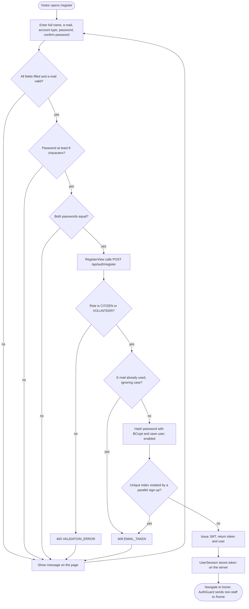
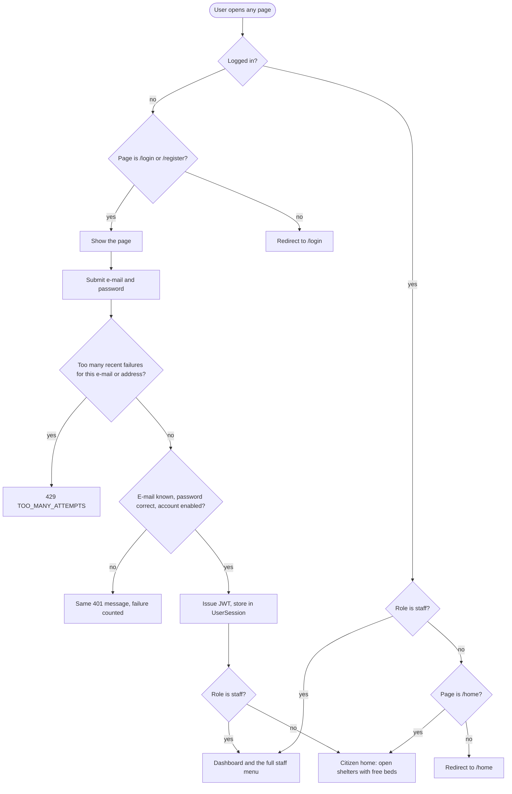
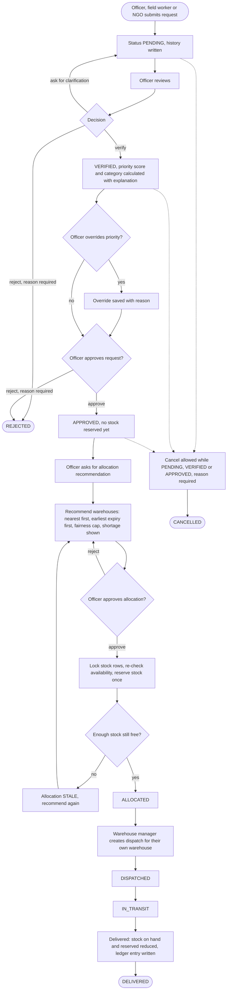
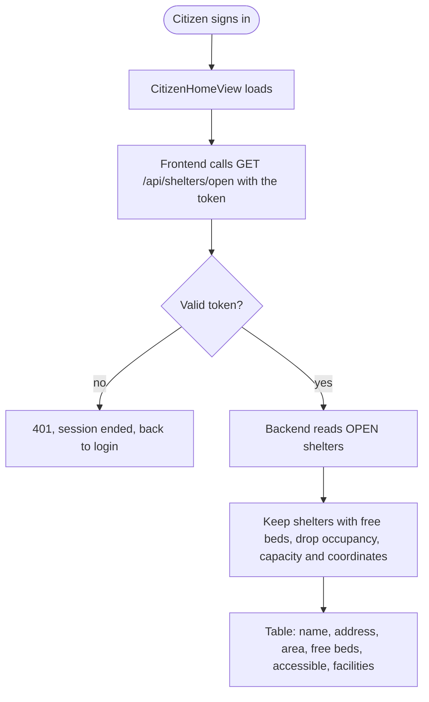

# Activity diagrams

## 1. Sign up

## 2. Log in and role routing

## 3. Relief request lifecycle

State names and rules come from `docs/API_CONTRACT.md` section 1.

Every step writes a row to `request_history` and an `audit_logs` entry in the same transaction. Cancelling after ALLOCATED is not supported in the MVP (open decision O3).

## 4. Citizen finds a shelter

