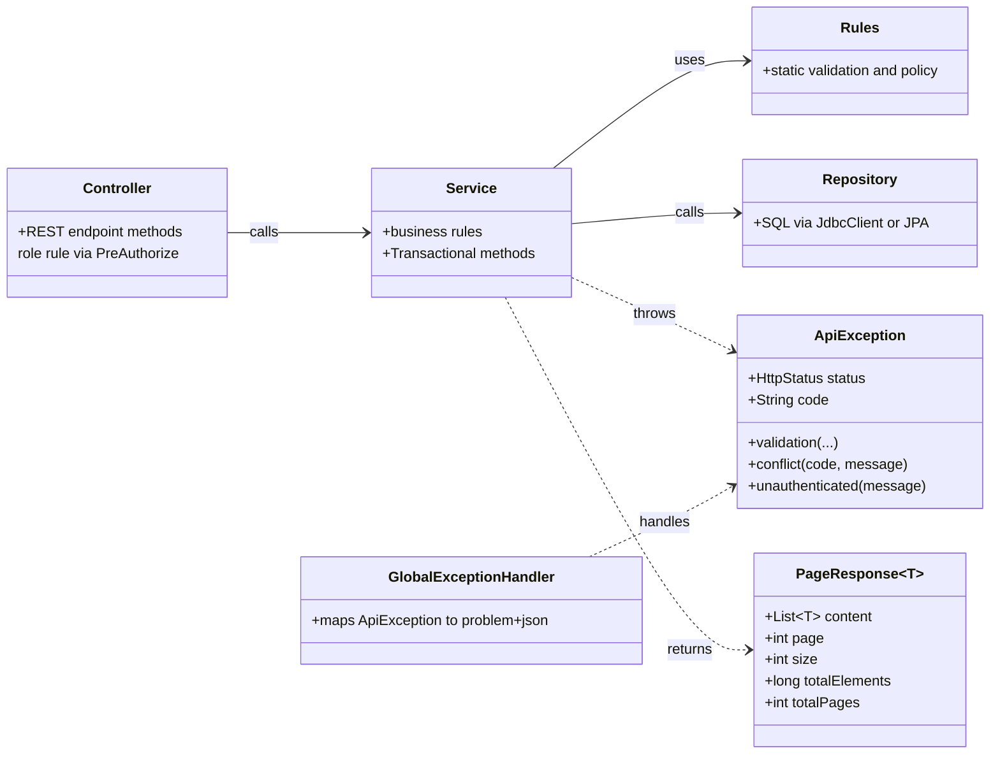
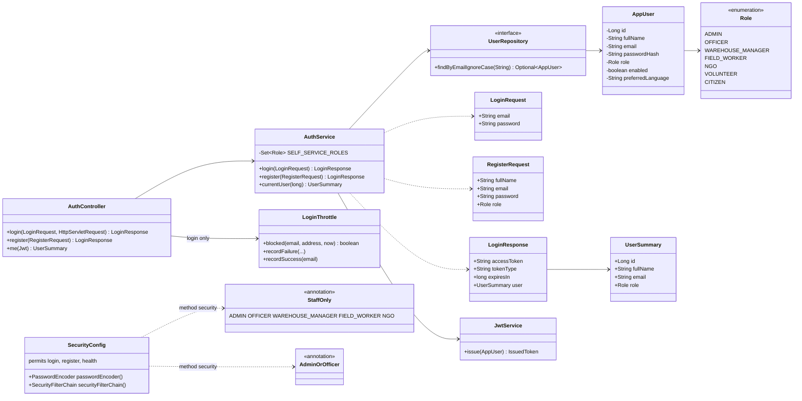
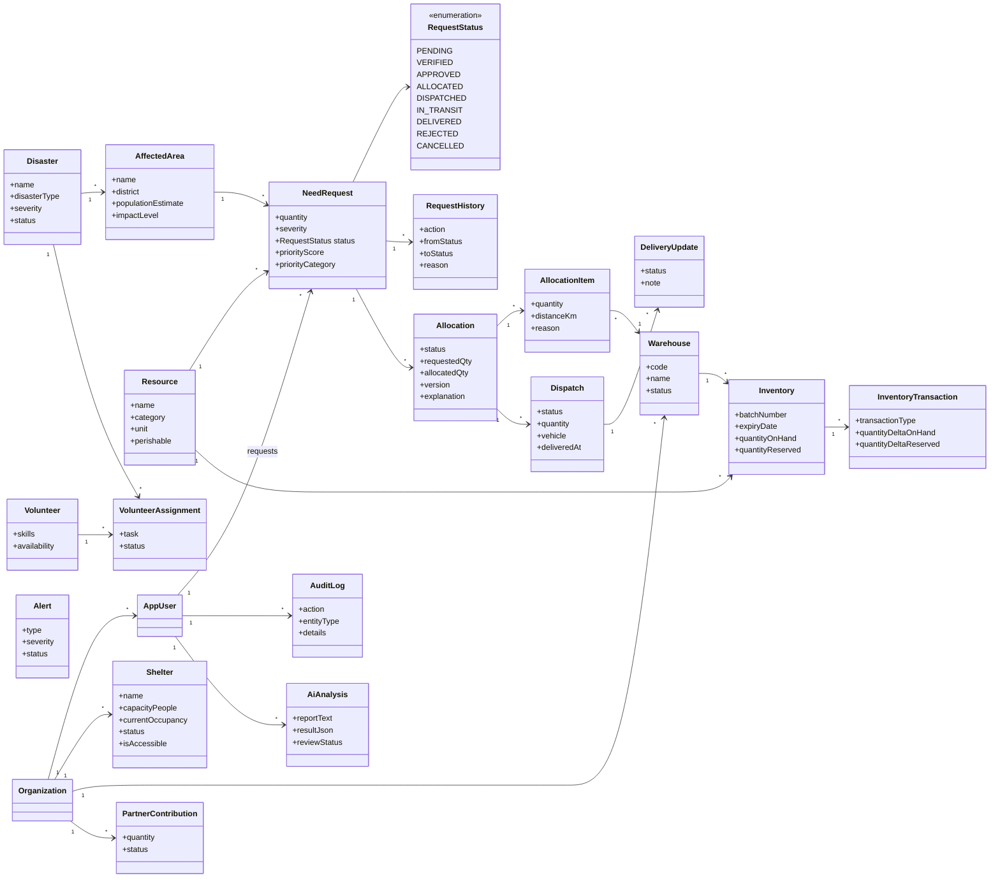
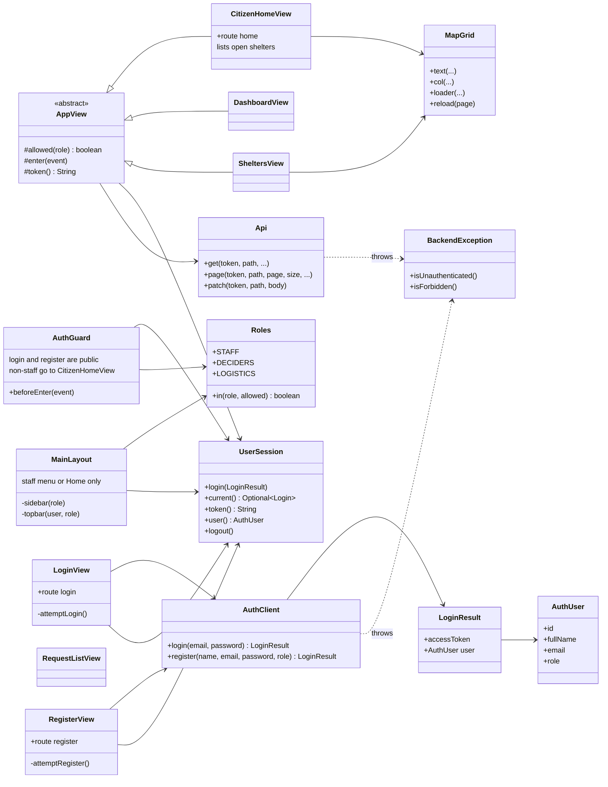

# Class diagram

Packages are `com.disasterrelief.backend` (Spring Boot REST API, port 8080) and `com.disasterrelief.frontend` (Vaadin Flow UI, port 8081). Only the main classes are drawn; each backend feature package follows the same layering: Controller, Service, Repository.

## 1. Backend layering (shared pattern)

Feature packages using this pattern: `disaster`, `affectedarea`, `request`, `priority`, `allocation`, `dispatch`, `inventory`, `warehouse`, `resource`, `shelter`, `volunteer`, `partner`, `ai`, `alert`, `audit`, `analytics`, `report`, `map`, `dashboard`, `system`.

## 2. Authentication, sign-up and security (backend)

`register` rejects any role outside `SELF_SERVICE_ROLES` (CITIZEN, VOLUNTEER), rejects a duplicate e-mail with 409 `EMAIL_TAKEN`, stores a BCrypt hash, and returns the same token response as `login`.

## 3. Relief domain model

These are persistence concepts (tables, see `ER_DIAGRAM.md`). The backend uses JDBC repositories and DTO records for most of them; only `AppUser` is a JPA entity.

## 4. Frontend (Vaadin)

The JWT is held in `UserSession` on the server side and is never sent to the browser. `Roles` only decides what the UI shows; the backend enforces the real permission on every call.
