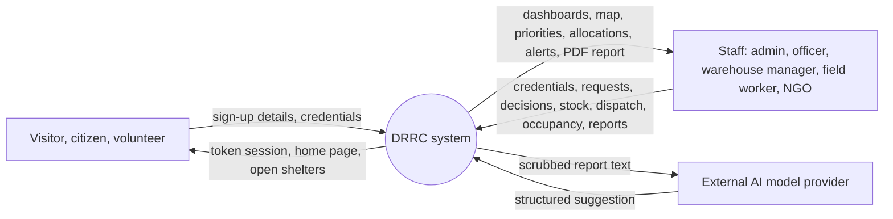
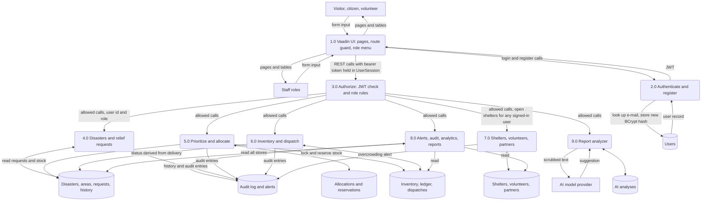
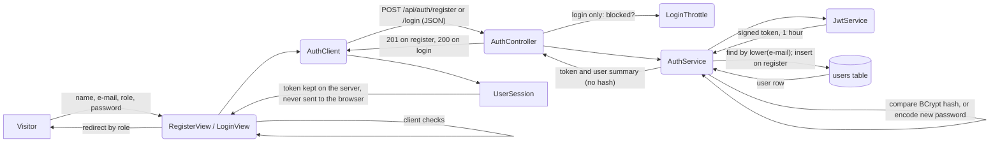
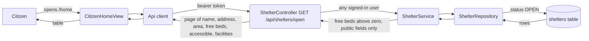

# Data flow diagrams

Notation: rectangles are external entities, rounded boxes are processes, open-ended boxes are data stores.

## Level 0: context diagram

The AI provider is optional. Without `AI_API_KEY` the analyzer answers 503 and nothing else is affected.

## Level 1: main processes and data stores

## Level 2: sign-up and sign-in data flow

## Level 2: citizen shelter lookup

