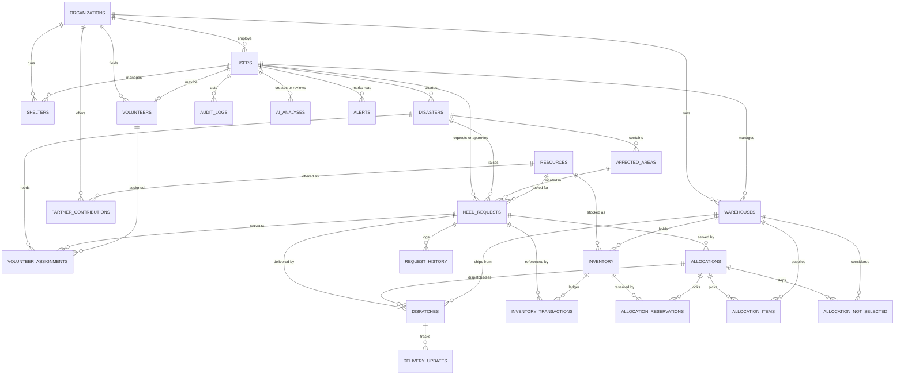
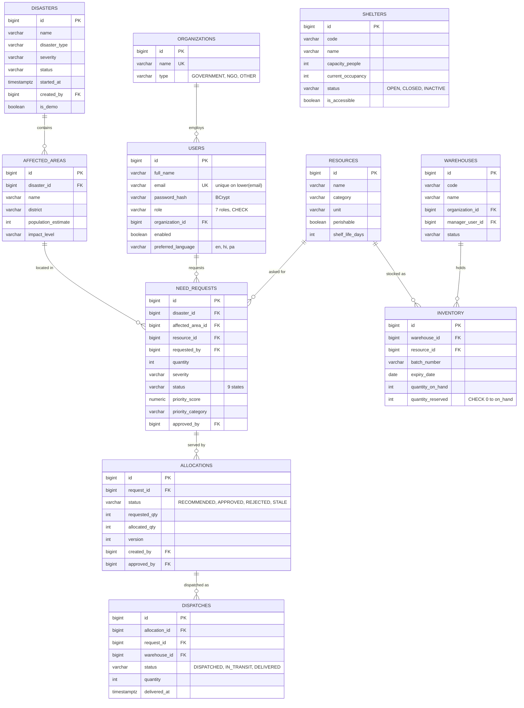

# Entity relationship diagram

Source: `database/migrations/V1` to `V11` (PostgreSQL + PostGIS, managed by Flyway). 23 tables. Types are shortened; every table has a `BIGSERIAL id` primary key. PostGIS `geography` columns: `disasters.epicentre`, `affected_areas.location` and `boundary`, `warehouses.location`, `shelters.location`, `volunteers.location`.

## 1. Whole schema (relationships)

## 2. Core tables with columns

## 3. Supporting tables

```mermaid
erDiagram
    REQUEST_HISTORY {
        bigint id PK
        bigint request_id FK
        varchar action
        varchar from_status
        varchar to_status
        bigint actor_user_id FK
        text reason
    }
    INVENTORY_TRANSACTIONS {
        bigint id PK
        bigint inventory_id FK
        varchar transaction_type
        int quantity_delta_on_hand
        int quantity_delta_reserved
        bigint request_id FK
        bigint actor_user_id FK
    }
    ALLOCATION_ITEMS {
        bigint id PK
        bigint allocation_id FK
        bigint warehouse_id FK
        int quantity
        numeric distance_km
        text reason
    }
    ALLOCATION_NOT_SELECTED {
        bigint id PK
        bigint allocation_id FK
        bigint warehouse_id FK
        text reason
    }
    ALLOCATION_RESERVATIONS {
        bigint id PK
        bigint allocation_id FK
        bigint inventory_id FK
        int quantity
        boolean dispatched
    }
    DELIVERY_UPDATES {
        bigint id PK
        bigint dispatch_id FK
        varchar status
        bigint actor_user_id FK
    }
    AUDIT_LOGS {
        bigint id PK
        bigint actor_user_id FK
        varchar actor_role
        varchar action
        varchar entity_type
        bigint entity_id
        text details
    }
    ALERTS {
        bigint id PK
        varchar type
        varchar severity
        varchar message
        varchar entity_type
        bigint entity_id
        varchar status "NEW or READ"
        bigint read_by FK
    }
    VOLUNTEERS {
        bigint id PK
        bigint user_id FK
        bigint organization_id FK
        varchar full_name
        varchar skills
        varchar availability
    }
    VOLUNTEER_ASSIGNMENTS {
        bigint id PK
        bigint volunteer_id FK
        bigint disaster_id FK
        bigint request_id FK
        varchar task
        varchar status
        bigint assigned_by FK
    }
    PARTNER_CONTRIBUTIONS {
        bigint id PK
        bigint organization_id FK
        bigint resource_id FK
        int quantity
        varchar status
        bigint decided_by FK
    }
    AI_ANALYSES {
        bigint id PK
        text report_text "PII scrubbed"
        varchar model
        varchar status
        text result_json
        varchar review_status "UNREVIEWED until a person reviews"
        bigint reviewed_by FK
        bigint created_by FK
    }
```

## Rules the schema enforces
- `users.email` is unique case-insensitively (index on `lower(email)`). This is what makes a duplicate sign-up fail with 409, even when two sign-ups race.
- `inventory`: `quantity_reserved` is never negative and never above `quantity_on_hand` (CHECK), the backstop for concurrent allocation approvals.
- `audit_logs` is append-only (database trigger); `inventory_transactions` is an append-only ledger.
- `need_requests` references `affected_areas(id, disaster_id)`, so a request cannot point at an area of a different disaster.
- Foreign keys are `ON DELETE RESTRICT`: history is never silently deleted.
- Self-registered users are plain `users` rows with role CITIZEN or VOLUNTEER and no organization; sign-up does not create a `volunteers` row.
