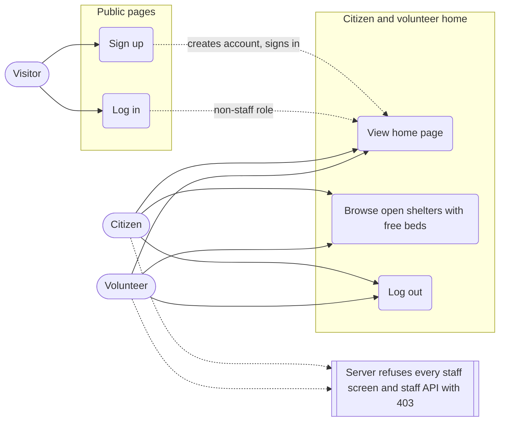
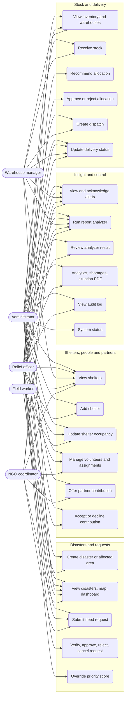

# Use case diagram

Roles come from `Role.java`: ADMIN, OFFICER, WAREHOUSE_MANAGER, FIELD_WORKER, NGO, VOLUNTEER, CITIZEN. "Staff" means the first five (see `StaffOnly.java`). VOLUNTEER and CITIZEN are the two roles anyone can pick at public sign-up; the other roles are issued by an administrator.

## 1. Public access, citizens and volunteers

Sign-up creates only a CITIZEN or VOLUNTEER account (default CITIZEN). Asking for any other role returns 400. An already used e-mail returns 409 `EMAIL_TAKEN`.

## 2. Staff roles

Notes from the code:
- Request approval and allocation approval are different actions, by OFFICER only (ADMIN excluded, open decision O1).
- `POST /api/requests` is limited to OFFICER, FIELD_WORKER and NGO. Public citizen reporting is open decision O4 and is not built.
- Dispatch creation is ADMIN and WAREHOUSE_MANAGER; delivery status changes also allow OFFICER and FIELD_WORKER.
- A warehouse manager acts only on their own warehouse, and a volunteer only on their own record (`SECURITY_REVIEW.md`).
- Individual role lists were read from the controllers; confirm any single cell against the controller before relying on it.
